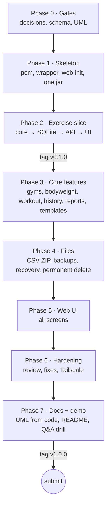

# Myophoria: Build Plan and Shared Model Context

This is the shared memory between the developer and every model (Opus plans, Sonnet executes, Haiku explains). A model should be able to do its job from **this file, CLAUDE.md, and the few files a task card names**, without re-reading the repo or an old transcript.

- Domain rules live in `handoff.md` and are referenced by section (for example "handoff §7.2"). Do not copy them here.
- Confirmed decisions are logged in `docs/DECISIONS.md`.
- This file holds: protocol (§0), board (§1), pending decisions (§2), architecture (§3), class design (§4), schema (§5), API and CSV contracts (§6), task cards (§7), questions (§8), log (§9).

---

## 0. Protocol (every model reads this first)

### 0.1 Roles

| Role | Model | Does | Never |
|---|---|---|---|
| Planner | Opus | Resolves questions in §8, edits contracts (§2–§6) and task cards (§7), reviews each phase, decides design questions itself | Asks the developer for approval of code or design (autonomous mode, §0.2) |
| Executor | Sonnet | Runs the next `TODO` task whose dependencies are `DONE` (or the task the developer names), updates §1 and §9, commits | Edits §2–§6, skips a planner review task, invents library versions, adds classes/deps not in §4 |
| Explainer | Haiku | Answers questions from this file plus named source files; runs Q&A drills | Edits code or this file (it may only append to §8) |

### 0.2 Session routine

1. **Start clean:** run `/clear` before each task and after every `/model` switch. Switching models mid-conversation keeps the whole transcript, and the new model re-reads (and is billed for) all of it, with no prompt cache carried over. CLAUDE.md loads automatically and points here; that is all the context needed.
2. Read §0, §1, your task card in §7, and **only** the files and sections the card lists under *Read*.
3. Set the task to `DOING` in §1, do the work, run every *Done when* check.
4. Set the task to `DONE` (or `REVIEW` for planner-reviewed tasks), add one line to §9, commit.
5. **Blocked, or a contract looks wrong?** Do not improvise. Set `BLOCKED`, write a question in §8 naming the task, and stop. The planner (Opus) answers it; the developer is only asked about scope or personal preferences.

Statuses: `TODO`, `DOING`, `DONE`, `REVIEW`, `BLOCKED`.

**Autonomous mode (decided 2026-11-25):** the developer does not review code or approve designs during the build. Models work through the board in order ("continue" or "go" from the developer means: run the next tasks), decide within the contracts, and stop only at `BLOCKED` or at a planner review task when the executing model is not Opus. The developer reviews and studies the finished program before the defense (T7.4–T7.5).

### 0.3 Git (branch per phase)

- Phase start: `git switch main && git switch -c <phase branch>` (branch names are in §1).
- One Conventional Commit per task, scope = layer: `feat(core): add exercise hierarchy`, `feat(api): ...`, `feat(web): ...`, `chore: ...`, `docs: ...`, `test(core): ...`.
- Phase end: planner review task passes → `git switch main && git merge --no-ff <branch>`; tag where the board says.
- Never commit `data/`, `backups/`, `exports/`, `*.db*`, `node_modules/`.

### 0.4 Code rules (all executors)

- **Core purity:** `myophoria.core` never imports Javalin, JDBC or Jackson.
- **Entities** (`core.model`): classic classes; private fields; constructor assigns through the validated setters; setters throw `InvalidWorkoutInputException`; plain getters; nullable fields are documented, not `Optional`.
- **Records** only for API DTOs (`api`) and service result values (`core.service`).
- Prefer for-each loops and named `Comparator`s over long stream chains: every line gets explained live in the Q&A.
- One-line Javadoc on every public class and public method in `core`.
- No class, dependency, endpoint or column that §4–§6 do not list. Need one? Ask in §8.
- **Versions:** never write a version from memory. Look up the latest stable release (Maven Central / npm) when adding it, and note it in §9.
- Resources: try-with-resources for streams, connections, statements. `finally` only for non-resource cleanup (temp files).

### 0.5 Standard checks

```bash
./mvnw -q verify                                                     # build + all tests
! grep -rnE '^import (io\.javalin|java\.sql|javax\.sql|com\.fasterxml)' src/main/java/myophoria/core   # core purity
(cd web && npm run check && npm run build)                           # web types + build
```

API smoke tests use httpie against `./mvnw -q exec:java` or the built jar, e.g. `http :7070/api/v1/exercises`.

---

## 1. Board

| ID | Task | Model | Depends | Status |
|---|---|---|---|---|
| **Phase 0** | **Plan and approval gates** (on `main`, docs only) | | | |
| T0.1 | Gate A: resolve §2 pending decisions and gaps | Opus + dev | – | DONE |
| T0.2 | Gate B (handoff Step 1): approve schema §5 | Opus + dev | T0.1 | DONE |
| T0.3 | Gate C (handoff Step 2): approve class design §4, write `docs/uml/classes.md` draft | Opus + dev | T0.2 | DONE |
| **Phase 1** | **Skeleton**, branch `chore/skeleton` | | | |
| T1.1 | Clean scaffold leftovers | Sonnet | T0.3 | DONE |
| T1.2 | `pom.xml`, Maven Wrapper, hello `Main` | Sonnet | T1.1 | DONE |
| T1.3 | Web project init (Svelte, Vite, TS, Tailwind) | Sonnet | T1.1 | DONE |
| T1.4 | One-jar integration check | Sonnet | T1.2, T1.3 | DONE |
| **Phase 2** | **Exercise slice end to end**, branch `feat/exercise-slice`, tag `v0.1.0` | | | |
| T2.1 | Core foundations + Exercise hierarchy | Sonnet | T1.4 | DONE |
| T2.2 | Database, Migrator, `V1__init.sql`, SqliteExerciseRepository | Sonnet | T2.1 | DONE |
| T2.3 | ExerciseService (no permanent delete yet) | Sonnet | T2.2 | DONE |
| T2.4 | API foundation + ExerciseController | Sonnet | T2.3 | DONE |
| T2.5 | Web: API client + basic Exercises screen | Sonnet | T2.4 | DONE |
| T2.6 | Phase review, merge, tag | Opus | T2.5 | DONE |
| **Phase 3** | **Core features**, branch `feat/core` | | | |
| T3.1 | Gyms vertical | Sonnet | T2.6 | DONE |
| T3.2 | Bodyweight vertical | Sonnet | T2.6 | DONE |
| T3.3 | Session + set model and repositories | Sonnet | T3.1 | DONE |
| T3.4 | WorkoutService (live flow, prefill) + endpoints | Sonnet | T3.2, T3.3 | DONE |
| T3.5 | HistoryService + endpoints | Sonnet | T3.4 | DONE |
| T3.6 | ReportService (summary, progression) + endpoints | Sonnet | T3.4 | DONE |
| T3.7 | Templates vertical | Sonnet | T3.4 | DONE |
| T3.8 | Phase review, merge | Opus | T3.5–T3.7 | DONE |
| **Phase 4** | **Files: CSV, backup, recovery**, branch `feat/files` | | | |
| T4.1 | CsvCodec | Sonnet | T3.8 | DONE |
| T4.2 | CsvSerializable on all entities | Sonnet | T4.1 | DONE |
| T4.3 | SqliteBackups + backup endpoint | Sonnet | T3.8 | DONE |
| T4.4 | CsvService ZIP export/import + endpoints | Sonnet | T4.2, T4.3 | DONE |
| T4.5 | Startup corruption recovery + status warnings | Sonnet | T4.3 | DONE |
| T4.6 | Permanent exercise delete + usage + deleted list | Sonnet | T4.3 | DONE |
| T4.7 | Phase review, merge | Opus | T4.4–T4.6 | TODO |
| **Phase 5** | **Web UI**, branch `feat/web` | | | |
| T5.0 | Settle open UI questions, refine T5.x cards | Opus + dev | T4.7 | TODO |
| T5.1 | Shell: router, nav, status banner, errors, confirm dialog | Sonnet | T5.0 | TODO |
| T5.2 | Start screen + exercise picker | Sonnet | T5.1 | TODO |
| T5.3 | Logging screen | Sonnet | T5.2 | TODO |
| T5.4 | Finish flow + summary + save as template | Sonnet | T5.3 | TODO |
| T5.5 | Exercises management (full) | Sonnet | T5.1 | TODO |
| T5.6 | History + session detail + backfill | Sonnet | T5.1 | TODO |
| T5.7 | Bodyweight + Gyms screens | Sonnet | T5.1 | TODO |
| T5.8 | Templates screen + start from template | Sonnet | T5.4 | TODO |
| T5.9 | Progression chart | Sonnet | T5.1 | TODO |
| T5.10 | Data screen: export, import, backup | Sonnet | T5.1 | TODO |
| T5.11 | Phase review, merge | Opus | T5.2–T5.10 | TODO |
| **Phase 6** | **Hardening + phone access**, branch `chore/hardening` | | | |
| T6.1 | Full code-quality review → fix list in §8 | Opus | T5.11 | TODO |
| T6.2 | Apply fix list | Sonnet | T6.1 | TODO |
| T6.3 | Tailscale serve + phone test | Sonnet + dev | T6.2 | TODO |
| **Phase 7** | **Docs and demo**, branch `docs/final`, tag `v1.0.0` | | | |
| T7.1 | UML from code (`docs/uml/classes.md`) | Sonnet | T6.2 | TODO |
| T7.2 | DESIGN, API, DATA_FORMAT, DECISIONS | Sonnet | T7.1 | TODO |
| T7.3 | README + Javadoc completeness | Sonnet | T7.2 | TODO |
| T7.4 | Demo script + defense study guide | Sonnet | T7.3 | TODO |
| T7.5 | Q&A drill with the developer | Haiku | T7.4 | TODO |
| T7.6 | Final review, merge, tag | Opus | T7.5 | TODO |

### Build flow



Every phase ends with an Opus review before merging. Backend is complete before the UI phase, so UI tasks never wait on missing endpoints. Phase 2 deliberately crosses every layer once, so later tasks copy an existing pattern instead of inventing one.

---

## 2. Decisions and pending items

### 2.1 Decided this planning session (logged in docs/DECISIONS.md)

- **Full v1 scope, no cuts.** The deadline does not drive the plan (handoff §10 cut list is retired).
- **Git: branch per phase**, one commit per task, no issues/PRs (replaces handoff §13 proposal).
- **This file is the shared plan and protocol** for all models.

### 2.2 Approved design rules (Gate A, 2026-11-25)

All rows were approved by the developer and are logged in docs/DECISIONS.md. They are binding; task cards reference them by ID. The contracts in §4–§6 already reflect them.

| # | Topic | Rule | Why |
|---|---|---|---|
| D1 | Migrations | Own `Migrator` (numbered SQL resources + `PRAGMA user_version`) instead of Flyway. Same file naming `db/migration/V1__init.sql`. | One less dependency, explainable JDBC, no history table in the DB/backups. Switching to Flyway later is a pom line. |
| G1 | Open vs backfilled sessions | Add `is_open` column; partial unique index on `is_open = 1`. `started_at` and `ended_at` both nullable. Backfilled sessions are inserted closed. | Handoff §14 uses `ended_at IS NULL` for "open", but §7.5 allows backfilled sessions with no end time: they would look open and block new workouts. |
| G2 | Subclass behavior | Overrides with a v1 caller: `validateWeight` (Calisthenics allows 0), `requiresBodyweight` (Calisthenics), `weightLabel` (shown beside KG on the logging screen: "total", "per dumbbell", "stack", "plates", "added"), `formatSet` (Dumbbell "30 kg each", Calisthenics "70 \| 20 kg"). **Drop `usesPlates()` until the v2 plate calculator.** | Handoff §6 lists `usesPlates`, but nothing in v1 calls it, and Barbell/Stack/PlateLoaded would otherwise be indistinguishable in the Q&A. |
| G3 | Name uniqueness | Store `name_key` (NFC, trimmed, single spaces, `toLowerCase(Locale.ROOT)`) computed in Java; unique partial index on active rows. Applies to exercises **and gyms**. | SQLite `NOCASE` folds ASCII only (handoff §12). Gym uniqueness is not stated anywhere; duplicate gym names would make the picker ambiguous. |
| G4 | Bodyweight snapshot unit | Snapshot is stored in the set's unit; prefill converts the latest bodyweight entry into it. | Sets have one unit column; handoff does not say which unit the snapshot uses. |
| G5 | Prefill unit | Prefill rows from the last session are converted into the remembered unit. | Handoff §7.2 "same gym and unit" is ambiguous when the unit changed. |
| G6 | Empty-session cleanup | Only **closed** sessions are deleted when their last set goes. An open session with zero sets stays until Finish (where the discard prompt applies). | Otherwise unticking the first set would delete the running workout. |
| G7 | Transactions | No transaction port in core. Multi-statement writes are single repository methods that run one transaction inside the adapter (set default gym, permanent delete, template save). Import is row-by-row by design and takes an automatic backup first. | Avoids a generic unit-of-work abstraction for 3 call sites. |
| G8 | Startup warnings reach the UI | `GET /api/v1/status` returns warnings from startup recovery; the UI shows a banner. | Handoff §8.6 says "never silent" but no channel exists. |
| G9 | Routing | Hash routing in `App.svelte`, no router dependency. | No server-side SPA fallback needed; one less dependency. |
| G10 | Import duplicates | Same UUID already present → skipped and counted as "already present" (never overwritten). Imported `is_default`/`is_open` are cleared if they would violate the one-default / one-open rule (reported). | Handoff §11 says "duplicates match on UUID" without saying what happens. |
| G11 | Templates and soft delete | Soft-deleted exercises are hidden from templates on read (restoring brings them back); permanent delete removes the row (explicit DELETE, no FK cascade). | Handoff §7.6 "drops out" does not say which delete. |
| G12 | Exercise display/initials | Initials and `weightLabel` are computed in Java and sent in the DTO. | Handoff §5.4: the front end never recomputes domain logic. |
| G13 | Config | Env vars read in `Main`: `MYOPHORIA_PORT` (7070), `MYOPHORIA_DATA_DIR` (`./data`, holds `myophoria.db` and `backups/`), `MYOPHORIA_ALLOWED_HOSTS` (comma list, adds to localhost). No config class. | Tailscale host name must be allowed by the Host/Origin guard. |
| G14 | Chart | Hand-written inline SVG line chart, no chart library. | One chart, one series. |
| G15 | Maven coordinates | `groupId` `myophoria`, `artifactId` `myophoria`, version `0.1.0-SNAPSHOT`. | Handoff §15 defers the group ID; this is the minimal choice. |

Rubric wording confirmed (2026-11-25): validated setters, plain getters.

Still open from the handoff (not blocking): peer evaluation for a solo project; Friday format; UI questions in handoff §8.7 (settled in T5.0).

---

## 3. Architecture

### 3.1 Shape

```
phone/laptop browser ──HTTPS (tailscale serve)──▶ Javalin on 127.0.0.1:7070
                                                   ├─ /            built Svelte SPA (classpath /public)
                                                   └─ /api/v1/*    controllers ─▶ core services ─▶ ports ─▶ SQLite adapters ─▶ data/myophoria.db
```

Single Maven module. Packages (dependencies point inward to `core`):

| Package | Holds | May import |
|---|---|---|
| `myophoria.core.model` | entities, enums, `VolumeCalculable` | `core.error`, `core.csv` |
| `myophoria.core.error` | the four custom exceptions | – |
| `myophoria.core.csv` | `CsvSerializable`, `CsvCodec` | `core.error` |
| `myophoria.core.port` | repository + backup interfaces | `core.model` |
| `myophoria.core.service` | use cases + result records | all of `core` |
| `myophoria.persistence` | SQLite adapters, `Database`, `Migrator`, `SqliteBackups` | `core`, `java.sql` |
| `myophoria.api` | `Main`, controllers, `ErrorHandlers` | everything |

### 3.2 Request flow

handoff §5.3. In code: controller parses JSON into a nested DTO record → calls one service method → service validates (entity setters + rules), uses ports, throws custom exceptions → controller maps the result to a DTO → `ErrorHandlers` maps exceptions to the §6.1 error format.

### 3.3 Startup sequence (`Main`)

1. Read env (G13). Create the data dir if missing.
2. `Database.open()`: if the DB file exists, run `PRAGMA quick_check`; on failure or "not a database", rename it to `myophoria.db.corrupt-<timestamp>`, copy the newest backup in `backups/` into place (if any) and record a warning. Then migrate. Returns `List<String> warnings`.
3. Build adapters → services → controllers (manual wiring, no DI framework).
4. Javalin: bind `127.0.0.1`, static files from classpath `/public`, Host/Origin guard, routes, exception handlers. Start.

### 3.4 Where logic lives

handoff §5.4. SQL loads and stores; services filter, search, sort and aggregate with `ArrayList`, `HashMap`, `Set`/`EnumSet`. Repositories expose `findAll`-style loads; filtering is not pushed into SQL.

### 3.5 Rubric map (keep current; used in review and demo)

| Rubric item | Where it shows |
|---|---|
| Class design | §4 entities with validated setters; services split by use case |
| Inheritance/polymorphism/abstraction | `Exercise` + 5 subclasses called through `Exercise` refs and `List<Exercise>`; `VolumeCalculable` (2 impls); `CsvSerializable` (6 entity types, 10 classes incl. subclasses); ports (SQLite impl + test fakes) |
| GUI | Svelte screens §7 Phase 5 |
| Collections | `ExerciseService` (HashMap by name key, EnumSet filter), `ReportService` (LinkedHashMap grouping, sorting), `CsvService` (HashSet of imported IDs) |
| Functionality | full CRUD + search/filter + summary/progression reports |
| Documentation/UML | docs/*, Javadoc, `docs/uml/classes.md` from code |
| Exceptions | 4 custom exceptions, `ErrorHandlers`, checked `CorruptedCsvException` caught per row, `finally` temp-file cleanup |
| File handling | SQLite, CSV ZIP export/import, `VACUUM INTO` backups, corrupted DB/CSV recovery |

---

## 4. Class design (approved in T0.3, 2026-11-25; diagram in docs/uml/classes.md)

Signatures are the contract; bodies are up to the executor. `?` marks a nullable value. All IDs are `String` UUIDs generated by the service that creates the entity (`UUID.randomUUID()`); times are `Instant` (UTC), days are `LocalDate`. Services that stamp a time (`ExerciseService`, `GymService`, `WorkoutService`, `CsvService`) take a `java.time.Clock` constructor argument so tests are deterministic; `Main` passes `Clock.systemUTC()`.

### 4.1 `core.model`

```java
enum EquipmentType { BARBELL, DUMBBELL, STACK, PLATE_LOADED, CALISTHENICS }
enum Laterality    { BILATERAL, UNILATERAL }
enum SetType       { WARMUP, WORKING, FAILURE;  boolean isWorking() /* WORKING or FAILURE */ }
enum Unit          { KG(1.0), LB(0.45359237);  double convert(double value, Unit to) }

interface VolumeCalculable { double volume(Unit reportingUnit); }

abstract class Exercise implements CsvSerializable {
    // id (final), name, nameKey, laterality, deletedAt?
    protected Exercise(String id, String name, Laterality laterality, Instant deletedAt)
    static Exercise of(EquipmentType type, String id, String name, Laterality laterality, Instant deletedAt) // the only type→subclass switch (handoff §6.6)
    static String nameKey(String name)
    abstract EquipmentType type();
    abstract String weightLabel();
    void validateWeight(double weight)            // default: > 0
    boolean requiresBodyweight()                  // default: false
    String formatSet(double weight, Unit unit, Double bodyweight)  // default "100 kg"
    double warmupWeight(double lastTopWeight)     // 0.8 × lastTopWeight
    String initials()                             // handoff §7.3
    void setName(String) ; void setLaterality(Laterality)
    void softDelete(Instant at) ; void restore() ; boolean isDeleted()
    String[] toCsvRow() ; static Exercise fromCsvRow(String[] row) throws CorruptedCsvException
}
class BarbellExercise       extends Exercise  // weightLabel "total"
class DumbbellExercise      extends Exercise  // weightLabel "per dumbbell", formatSet "30 kg each"
class StackExercise         extends Exercise  // weightLabel "stack"
class PlateLoadedExercise   extends Exercise  // weightLabel "plates"
class CalisthenicsExercise  extends Exercise  // weightLabel "added", validateWeight ≥ 0, requiresBodyweight true, formatSet "70 | 20 kg"

class Gym implements CsvSerializable {             // id, name, nameKey, isDefault, deletedAt?
    void setName(String) ; void setDefault(boolean) ; void softDelete(Instant) ; boolean isDeleted()
}
class BodyweightEntry implements CsvSerializable { // id, weight (> 0), unit, recordedAt, localDate
}
class WorkoutSet implements VolumeCalculable, CsvSerializable {
    // id, sessionId, exerciseId, position (≥ 1), setType, weight (≥ 0), unit, reps (> 0), bodyweight?, completedAt
    double volume(Unit u)   // WARMUP → 0, else weight converted × reps (added weight only for Calisthenics)
}
class WorkoutSession implements VolumeCalculable, CsvSerializable {
    // id, gymId, localDate, startedAt?, endedAt?, open, List<WorkoutSet> sets (ArrayList)
    double volume(Unit u)            // sum of sets
    void finish(Instant now)         // sets endedAt, open = false
    Instant effectiveEnd()           // endedAt, else last set's completedAt, else null
    Duration duration()              // null unless start and effective end exist
}
class WorkoutTemplate implements CsvSerializable { // id, name, List<String> exerciseIds (ordered)
}
```

Exercise-dependent set rules (`validateWeight`, `requiresBodyweight`) are applied by `WorkoutService`, which loads the `Exercise`; `WorkoutSet` itself only checks its own fields.

### 4.2 `core.error` (handoff §6 table)

```java
class InvalidWorkoutInputException extends RuntimeException
class NotFoundException            extends RuntimeException  // (String resourceType, String id)
class DuplicateResourceException   extends RuntimeException  // (String resourceType, String existingId, boolean softDeleted)
class CorruptedCsvException        extends Exception         // (String file, int line, String reason)
```

### 4.3 `core.csv`

```java
interface CsvSerializable { String[] toCsvRow(); }   // each entity also has static HEADER and static fromCsvRow(String[])
final class CsvCodec {
    static String formatRow(String[] fields)                        // RFC 4180 quoting
    static final DateTimeFormatter TIMESTAMP   // uuuu-MM-dd'T'HH:mm:ss.SSS'Z' in UTC; shared by CSV and persistence for every Instant
    static List<String[]> parse(Reader in, String fileName) throws CorruptedCsvException, IOException
}                                                                   // handles quotes, embedded commas/newlines, BOM, CRLF/LF; checks column count
```

### 4.4 `core.port`

```java
interface ExerciseRepository {
    List<Exercise> findAll(); Exercise findById(String id) /* ? */; void insert(Exercise e); void update(Exercise e);
    int countSets(String exerciseId); int countSessions(String exerciseId);
    void deletePermanently(String id);   // one transaction, explicit DELETEs in this order: sets, emptied closed sessions, template rows, exercise (no FK cascade)
}
interface GymRepository        { List<Gym> findAll(); Gym findById(String id); void insert(Gym g); void update(Gym g); void makeDefault(String id); /* one tx */ }
interface SessionRepository    { List<WorkoutSession> findAll(); /* with sets */ WorkoutSession findById(String id); WorkoutSession findOpen(); void insert(WorkoutSession s); void update(WorkoutSession s); void delete(String id); }
interface SetRepository        { WorkoutSet findById(String id); void insert(WorkoutSet s); void update(WorkoutSet s); void delete(String id); }
interface BodyweightRepository { List<BodyweightEntry> findAll(); BodyweightEntry findById(String id); void insert(BodyweightEntry b); void update(BodyweightEntry b); void delete(String id); }
interface TemplateRepository   { List<WorkoutTemplate> findAll(); WorkoutTemplate findById(String id); void insert(WorkoutTemplate t); void update(WorkoutTemplate t); /* replaces rows, one tx */ void delete(String id); }
interface Backups              { String createBackup() throws IOException; /* returns file name */ }
```

`findById` returns `null` when missing; the **service** throws `NotFoundException`. Adapters wrap `SQLException` in `IllegalStateException` (→ 500).

### 4.5 `core.service`

| Service | Ports | Methods (summary) |
|---|---|---|
| `ExerciseService` | Exercise, Backups | `search(query?, Set<EquipmentType> types, boolean deleted)`, `get`, `create(name, type, laterality)`, `update(id, name, type, laterality)` (type change only if `countSets == 0`; rebuilds via `Exercise.of`), `softDelete`, `restore` (409 if active name taken), `usage(id)`, `deletePermanently(id)` (backup first; abort if backup fails) |
| `GymService` | Gym, Session | `list`, `create`, `rename`, `makeDefault`, `delete` (not default, not last active), `activeGym()` (handoff §7.4) |
| `WorkoutService` | Session, Set, Exercise, Gym, Bodyweight | `open()`, `start(gymId, localDate)`, `finish(id)` (400 if zero sets), `addSet(sessionId, SetInput)`, `updateSet(id, SetInput)`, `deleteSet(id)` (G6), `prefill(sessionId, exerciseId)` |
| `HistoryService` | Session, Gym | `list(HistoryFilter)`, `get`, `backfill(gymId, localDate, startedAt?, endedAt?)`, `edit(id, gymId, localDate, startedAt?, endedAt?)`, `delete` |
| `ReportService` | Session, Exercise | `summary(sessionId, Unit)`, `progression(exerciseId, Unit)` |
| `BodyweightService` | Bodyweight | `list` (newest first), `latest`, `create`, `update`, `delete` |
| `TemplateService` | Template, Exercise, Session | `list` (G11 filtering), `create(name, exerciseIds)`, `update`, `delete`, `saveFromSession(sessionId, name)` (exercise order = first-set order) |
| `CsvService` | all repos, Backups | `export(OutputStream)`, `importZip(InputStream) → ImportReport` |

Result records (in `core.service`): `SetInput(exerciseId, setType, weight, unit, reps, bodyweight?, position)`, `Prefill(unit, List<PrefillRow> rows, warmupWeight?, bodyweight?)`, `PrefillRow(setType, weight, reps)`, `HistoryFilter(from?, to?, gymId?, exerciseId?)`, `SessionSummary(...)`, `ExerciseSummary(exerciseId, name, workingSets, topWeight, averageWeight, volume)`, `ProgressPoint(localDate, topWeight)`, `Usage(sets, sessions)`, `ImportReport(Map<String, FileReport>)`, `FileReport(imported, alreadyPresent, List<String> skipped, List<String> orphans, List<String> nameConflicts)`.

**Prefill algorithm** (handoff §7.2, G4, G5):
1. `unit` = unit of the most recent set (by `completedAt`) of this exercise in any session at this gym; default `KG`.
2. `last` = most recent session ≠ current at this gym containing this exercise (order: `localDate`, then `startedAt`).
3. `rows` = `last`'s sets of this exercise in position order, weights converted to `unit`. Empty if none (UI shows one blank row).
4. `warmupWeight` = `exercise.warmupWeight(max working weight in last, converted)`, or null.
5. `bodyweight` = if `exercise.requiresBodyweight()`: latest bodyweight entry converted to `unit`, else null.

**Summary** (handoff §7.5): total sets, working sets, total volume, per exercise (order of first set) top and average working weight, start, effective end, duration, all converted to the reporting unit.

### 4.6 `myophoria.persistence`

`Database(Path dataDir)`: `List<String> open()` (§3.3), `Connection connect()` (new connection each call; `foreign_keys=ON`, `busy_timeout=5000`; WAL set once in `open`). `Migrator.migrate(Connection)` (D1). `SqliteExerciseRepository`, `SqliteGymRepository`, `SqliteSessionRepository` (loads all sets in one query, groups with a `HashMap`), `SqliteSetRepository`, `SqliteBodyweightRepository`, `SqliteTemplateRepository`, `SqliteBackups` (`VACUUM INTO` a `.tmp` file, rename on success, `finally` delete leftover tmp).

### 4.7 `myophoria.api`

`Main` (startup §3.3, wiring, Host/Origin guard). `ErrorHandlers` (§6.1). Controllers, each with nested request/response records and a method that registers its routes: `ExerciseController`, `GymController`, `WorkoutController` (`/sessions`, `/sets`, prefill), `HistoryController`, `ReportController`, `BodyweightController`, `TemplateController`, `DataController` (status, export, import, backups).

**Host/Origin guard:** reject (403) any `/api` request whose `Host`, or `Origin` if present, is not `localhost`, `127.0.0.1` (any port) or in `MYOPHORIA_ALLOWED_HOSTS`.

### 4.8 `web/`

```
web/src/
  App.svelte          hash router, bottom nav, status banner
  lib/api.ts          one typed function per endpoint; throws ApiError {error, message, details}
  lib/types.ts        mirrors the DTOs in §6
  lib/format.ts       display rounding only
  screens/*.svelte    one per screen (handoff §8.1)
  components/*.svelte shared pieces (Badge, SetRow, ConfirmDialog, ...)
```

Vite dev server proxies `/api` to `http://127.0.0.1:7070`. `build.outDir = ../src/main/resources/public`, `emptyOutDir: true`.

---

## 5. Schema (approved in T0.2, 2026-11-25)

`src/main/resources/db/migration/V1__init.sql`. All tables are `STRICT` (SQLite rejects wrong value types). Timestamps are fixed-width ISO-8601 UTC text `2026-11-25T07:30:00.000Z`, always written with `CsvCodec.TIMESTAMP` (never `Instant.toString()`, whose length varies and breaks text sorting). Dates `YYYY-MM-DD`, booleans `0/1`, enums by name. Stored timestamps have millisecond precision, so services truncate `clock.instant()` with `.truncatedTo(ChronoUnit.MILLIS)` before putting it on an entity (otherwise a reloaded entity no longer equals the one in memory).

```sql
CREATE TABLE gyms (
  id          TEXT PRIMARY KEY,
  name        TEXT NOT NULL,
  name_key    TEXT NOT NULL,
  is_default  INTEGER NOT NULL DEFAULT 0 CHECK (is_default IN (0, 1)),
  deleted_at  TEXT
) STRICT;
CREATE UNIQUE INDEX gyms_one_default  ON gyms (is_default) WHERE is_default = 1;
CREATE UNIQUE INDEX gyms_active_name  ON gyms (name_key)   WHERE deleted_at IS NULL;

CREATE TABLE exercises (
  id              TEXT PRIMARY KEY,
  name            TEXT NOT NULL,
  name_key        TEXT NOT NULL,
  equipment_type  TEXT NOT NULL CHECK (equipment_type IN ('BARBELL','DUMBBELL','STACK','PLATE_LOADED','CALISTHENICS')),
  laterality      TEXT NOT NULL DEFAULT 'BILATERAL' CHECK (laterality IN ('BILATERAL','UNILATERAL')),
  deleted_at      TEXT
) STRICT;
CREATE UNIQUE INDEX exercises_active_name ON exercises (name_key) WHERE deleted_at IS NULL;

CREATE TABLE workout_sessions (
  id          TEXT PRIMARY KEY,
  gym_id      TEXT NOT NULL REFERENCES gyms (id),
  local_date  TEXT NOT NULL,
  started_at  TEXT,
  ended_at    TEXT,
  is_open     INTEGER NOT NULL DEFAULT 0 CHECK (is_open IN (0, 1))
) STRICT;
CREATE UNIQUE INDEX sessions_one_open ON workout_sessions (is_open) WHERE is_open = 1;
CREATE INDEX sessions_gym_date ON workout_sessions (gym_id, local_date);

CREATE TABLE workout_sets (
  id            TEXT PRIMARY KEY,
  session_id    TEXT NOT NULL REFERENCES workout_sessions (id) ON DELETE CASCADE,
  exercise_id   TEXT NOT NULL REFERENCES exercises (id),
  position      INTEGER NOT NULL CHECK (position >= 1),
  set_type      TEXT NOT NULL CHECK (set_type IN ('WARMUP','WORKING','FAILURE')),
  weight        REAL NOT NULL CHECK (weight >= 0),
  unit          TEXT NOT NULL CHECK (unit IN ('KG','LB')),
  reps          INTEGER NOT NULL CHECK (reps > 0),
  bodyweight    REAL CHECK (bodyweight IS NULL OR bodyweight > 0),
  completed_at  TEXT NOT NULL
) STRICT;
CREATE INDEX sets_session  ON workout_sets (session_id);
CREATE INDEX sets_exercise ON workout_sets (exercise_id);

CREATE TABLE bodyweight_entries (
  id           TEXT PRIMARY KEY,
  weight       REAL NOT NULL CHECK (weight > 0),
  unit         TEXT NOT NULL CHECK (unit IN ('KG','LB')),
  recorded_at  TEXT NOT NULL,
  local_date   TEXT NOT NULL
) STRICT;

CREATE TABLE workout_templates (
  id    TEXT PRIMARY KEY,
  name  TEXT NOT NULL
) STRICT;
CREATE TABLE template_exercises (
  template_id  TEXT NOT NULL REFERENCES workout_templates (id) ON DELETE CASCADE,
  exercise_id  TEXT NOT NULL REFERENCES exercises (id),
  position     INTEGER NOT NULL,
  PRIMARY KEY (template_id, position)
) STRICT;

-- Fixed ID so every database and every export share the same seeded gym.
INSERT INTO gyms (id, name, name_key, is_default) VALUES ('00000000-0000-0000-0000-000000000001', 'Default', 'default', 1);
```

Notes: "exactly one default" = the index (at most one) + `GymService` (never zero). References to `exercises` have **no cascade**: an accidental hard delete fails on the foreign key instead of erasing history; permanent delete removes dependents explicitly (§4.4). Unit memory is a query, not a table. Javadoc of the bodyweight column: snapshot in the set's unit, required iff the exercise requires bodyweight (checked in Java).

---

## 6. API and file contracts

### 6.1 Errors

Every error is JSON: `{"error": CODE, "message": "...", "details": {...}}`. `details` is only present for duplicates: `{"resourceType", "existingId", "softDeleted"}`.

| Exception | CODE | HTTP |
|---|---|---|
| `InvalidWorkoutInputException`, malformed JSON/params | `INVALID_INPUT` | 400 |
| Host/Origin rejected | `FORBIDDEN` | 403 |
| `NotFoundException` | `NOT_FOUND` | 404 |
| `DuplicateResourceException` | `DUPLICATE_RESOURCE` | 409 |
| `CorruptedCsvException` (whole file unusable, e.g. bad manifest/header) | `CORRUPTED_CSV` | 422 |
| anything else (logged, message never exposed) | `INTERNAL` | 500 |

### 6.2 Endpoints (`/api/v1`)

`unit` query param = `kg` (default) or `lb`. Bodies are JSON; field names camelCase. `localDate` always comes from the client.

| Method + path | Body / query | Returns |
|---|---|---|
| `GET /status` | – | `{warnings: string[]}` |
| `GET /exercises` | `?q=&type=BARBELL,DUMBBELL&deleted=false` | `Exercise[]` (`{id, name, equipmentType, laterality, initials, weightLabel, deleted}`) |
| `GET /exercises/{id}` | – | `Exercise` |
| `POST /exercises` | `{name, equipmentType, laterality}` | 201 `Exercise` / 409 |
| `PUT /exercises/{id}` | same | `Exercise` |
| `DELETE /exercises/{id}` | – | 204 (soft) |
| `POST /exercises/{id}/restore` | – | `Exercise` / 409 |
| `GET /exercises/{id}/usage` | – | `{sets, sessions}` |
| `DELETE /exercises/{id}/permanent` | – | `{backupFile}` |
| `GET /exercises/{id}/progression` | `?unit=` | `{localDate, topWeight}[]` |
| `GET /gyms` | – | `Gym[]` (`{id, name, isDefault}`) active only |
| `GET /gyms/active` | – | `Gym` |
| `POST /gyms` · `PUT /gyms/{id}` | `{name}` | `Gym` |
| `POST /gyms/{id}/default` | – | `Gym` |
| `DELETE /gyms/{id}` | – | 204 |
| `GET /sessions/open` | – | `Session` or 204 |
| `POST /sessions/start` | `{gymId, localDate}` | 201 `Session` |
| `POST /sessions/{id}/finish` | – | `Session` |
| `GET /sessions/{id}/prefill` | `?exerciseId=` | `{unit, rows[{setType, weight, reps}], warmupWeight?, bodyweight?}` |
| `GET /sessions/{id}/summary` | `?unit=` | `SessionSummary` |
| `POST /sessions/{id}/template` | `{name}` | 201 `Template` |
| `POST /sessions/{id}/sets` | `{exerciseId, setType, weight, unit, reps, bodyweight?, position}` | 201 `Set` |
| `PUT /sets/{id}` · `DELETE /sets/{id}` | same / – | `Set` / 204 |
| `GET /sessions` | `?from=&to=&gymId=&exerciseId=` | `SessionHeader[]` (`{id, gymName, localDate, startedAt?, endedAt?, setCount, open}`) newest first |
| `GET /sessions/{id}` | – | `Session` (`{id, gymId, localDate, startedAt?, endedAt?, open, sets[]}`; each set includes `display` from `formatSet`) |
| `POST /sessions` | `{gymId, localDate, startedAt?, endedAt?}` | 201 `Session` (backfill, closed) |
| `PUT /sessions/{id}` | same | `Session` |
| `DELETE /sessions/{id}` | – | 204 |
| `GET /bodyweight` · `GET /bodyweight/latest` | – | `Entry[]` / `Entry` or 204 |
| `POST /bodyweight` · `PUT /bodyweight/{id}` | `{weight, unit, recordedAt, localDate}` | `Entry` |
| `DELETE /bodyweight/{id}` | – | 204 |
| `GET /templates` | – | `{id, name, exercises[]}` |
| `POST /templates` · `PUT /templates/{id}` | `{name, exerciseIds[]}` | `Template` |
| `DELETE /templates/{id}` | – | 204 |
| `GET /export` | – | `application/zip` download `myophoria-<timestamp>.zip` |
| `POST /import` | multipart `file` (zip) | `ImportReport` |
| `POST /backups` | – | `{file}` |

### 6.3 CSV bundle (export/import)

ZIP containing UTF-8 CSV files, header row first, RFC 4180 quoting, LF line endings on write (CRLF and a BOM accepted on read). Nulls are empty fields. Timestamps use `CsvCodec.TIMESTAMP`. Booleans `true`/`false`. Enums by name. Decimal point `.`.

| File | Columns |
|---|---|
| `manifest.csv` | `format_version,exported_at` (one row; version `1`) |
| `gyms.csv` | `id,name,is_default,deleted_at` |
| `exercises.csv` | `id,name,equipment_type,laterality,deleted_at` |
| `sessions.csv` | `id,gym_id,local_date,started_at,ended_at,is_open` |
| `sets.csv` | `id,session_id,exercise_id,position,set_type,weight,unit,reps,bodyweight,completed_at` |
| `bodyweight.csv` | `id,weight,unit,recorded_at,local_date` |
| `templates.csv` | `id,name,exercise_ids` (`;`-separated, ordered) |

Import order: manifest (wrong/missing version → whole import 422) → gyms → exercises → sessions → sets → bodyweight → templates. A missing file is reported and skipped. Bad row → skipped with `file:line reason` (checked `CorruptedCsvException` caught per row). Child of a skipped/missing parent → orphan. Same-UUID → already present (G10). Different UUID with an active name → name conflict, skipped. An automatic backup runs before the first write.

---

## 7. Task cards

Every card: **Read** (only these), **Write**, **Do**, **Done when**. The standard checks in §0.5 apply to every code task in addition to the listed ones.

### Phase 0

**T0.1 Gate A.** Planner walks the developer through §2.2, one item at a time. Approved items → docs/DECISIONS.md entries (date, decision, reason) and contract edits here; rejected ones → contracts adjusted. Also answer the rubric-wording question. Done when §2.2 is empty or explicitly deferred.

**T0.2 Gate B.** Planner explains §5 table by table (why each column, index, check). Done when the developer approves; record in DECISIONS.md.

**T0.3 Gate C.** Planner explains §4 and writes the Mermaid diagram to `docs/uml/classes.md` (classes, interfaces, exceptions, which collection each service uses). Done when approved.

### Phase 1 — `chore/skeleton`

**T1.1 Clean scaffold leftovers.**
- Read: CLAUDE.md, `.gitignore`, `flake.nix`, `README.md`.
- Do: `git rm -r src web/.gitkeep scaffold.sh` (the `lift` package folders and empty .gitkeeps; real folders appear with real files). README title → "Myophoria". Remove the JDK 21 fallback comment from `flake.nix` and CLAUDE.md (jdk25 evaluates on the pinned lock). Remove `web/dist/` from `.gitignore` (build goes to `src/main/resources/public/`). Replace "Per `scaffold.sh`" in CLAUDE.md with a plain statement. Run `nix fmt`.
- Done when: `git status` shows only these changes; `nix develop -c java -version` prints 25.

**T1.2 pom.xml + wrapper + hello Main.**
- Read: §0.4, §3.1, G15.
- Write: `pom.xml`, `mvnw`, `mvnw.cmd`, `.mvn/`, `src/main/java/myophoria/api/Main.java`.
- Do: `mvn -N wrapper:wrapper` (keep `mvnw` executable). pom: `maven.compiler.release` 25, UTF-8. Dependencies at the latest stable versions (look them up, log them in §9): Javalin, jackson-databind, jackson-datatype-jsr310, sqlite-jdbc, slf4j-simple, JUnit Jupiter (test, via BOM). Plugins: surefire, exec (`mainClass` myophoria.api.Main), shade (one runnable jar, main class set). `Main` starts Javalin on 127.0.0.1:7070 with `GET /api/v1/status` → `{"warnings":[]}`.
- Done when: `./mvnw -q verify`; `./mvnw -q exec:java` then `http :7070/api/v1/status` returns the JSON.

**T1.3 Web init.**
- Read: §4.8.
- Do: `npm create vite@latest web -- --template svelte-ts`; add Tailwind following its current Vite guide; Vite proxy + outDir from §4.8; replace the demo page with an empty `App.svelte` that fetches `/api/v1/status` and prints it. Add `engines.node` matching the Nix shell's Node major. Commit `package-lock.json`.
- Done when: `cd web && npm run check && npm run build` writes `src/main/resources/public/index.html`.

**T1.4 One-jar check.**
- Do: add Javalin static files (classpath `/public`) to `Main`. Build web, then `./mvnw -q package`, then `java -jar target/myophoria-*.jar`.
- Done when: `http :7070/` returns the SPA's index and the page shows the status JSON. Add the three build commands to README "Development".

### Phase 2 — `feat/exercise-slice`

**T2.1 Core foundations + Exercise hierarchy.**
- Read: §0.4, §4.1–4.3, handoff §6, §7.3.
- Write: all 4 enums, `VolumeCalculable`, the 4 exceptions, `CsvSerializable`, `Exercise` + 5 subclasses (`toCsvRow`/`fromCsvRow` may throw `UnsupportedOperationException` until T4.2). Tests: `ExerciseTest` (validation, `of` dispatch, every override, initials, nameKey), `UnitTest`.
- Done when: standard checks.

**T2.2 Persistence foundation.**
- Read: §3.3, §4.4 (ExerciseRepository), §4.6, §5, D1.
- Write: `V1__init.sql` (full §5), `Migrator`, `Database` (open + connect; recovery comes in T4.5, leave a TODO-free simple open), `SqliteExerciseRepository` (`deletePermanently` throws `UnsupportedOperationException` until T4.6). Test: migrate a temp-dir DB twice (idempotent), insert/find/update exercise round trip.
- Done when: standard checks; `sqlite3 <tmp db> .schema` matches §5.

**T2.3 ExerciseService.**
- Read: §4.5 (ExerciseService), handoff §7.3. 
- Do: all methods except `usage`/`deletePermanently` (T4.6). Duplicate check: `HashMap<String, Exercise>` keyed by name key across all exercises; active match → `DuplicateResourceException(softDeleted=false)`, deleted match → `softDeleted=true`. Search: case-insensitive contains on name, `EnumSet` type filter, sorted by name. Tests use an in-memory fake `ExerciseRepository` in `src/test/java/myophoria/core/fake/`.
- Done when: standard checks.

**T2.4 API foundation + exercises.**
- Read: §3.3, §4.7, §6.1, §6.2 (status + exercise rows), G13.
- Do: `Main` wiring with env config, Host/Origin guard, `ErrorHandlers`, `ExerciseController` (all exercise rows except usage/permanent/progression), `DataController` with `/status` (warnings from `Database.open()`).
- Done when: standard checks; httpie: create → 201, duplicate → 409 with details, bad body → 400 JSON, unknown id → 404 JSON, `Host: evil.com` → 403.

**T2.5 Web client + Exercises screen.**
- Read: §4.8, §6.1, §6.2 exercise rows.
- Do: `lib/types.ts`, `lib/api.ts` (exercise functions + ApiError), `App.svelte` minimal hash router, `screens/Exercises.svelte`: list with search and type chips, add form, soft delete; error message shown from `ApiError.message`.
- Done when: web checks; manual: add/search/delete works through `npm run dev` with the backend running.

**T2.6 Phase review (Opus).** Review the branch against §0.4 and §4 (structure, Q&A explainability). Fix list → §8 → Sonnet fixes. Then merge and tag `v0.1.0`.

### Phase 3 — `feat/core`

Each vertical = model (if not yet present) + port + service + SQLite adapter + controller + tests (service tests with fakes; one adapter round-trip test). Copy the Phase 2 patterns.

**T3.1 Gyms.** Read: §4.1 Gym, §4.4, §4.5 GymService, §6.2 gym rows, handoff §7.4, G3. Done when: standard checks; httpie: create, rename, makeDefault (old default cleared), delete default → 400, delete last → 400, `/gyms/active` falls back to default.

**T3.2 Bodyweight.** Read: §4.1, §4.5, §6.2 bodyweight rows, handoff §7.1. Done when: standard checks; CRUD via httpie.

**T3.3 Sessions + sets model and repositories.** Read: §4.1 WorkoutSet/WorkoutSession, §4.4, §4.6, §5, handoff §7.5, G1. Write: both entities with `volume`, `finish`, `effectiveEnd`, `duration`; `SqliteSessionRepository`, `SqliteSetRepository`. Tests: volume (warm-up 0, unit conversion, calisthenics added weight only), duration rules, repo round trip, one-open index rejects a second open session.

**T3.4 WorkoutService + live endpoints.** Read: §4.5 WorkoutService + prefill algorithm, §6.2 live session/set/prefill rows, handoff §7.1, §7.2, §7.5, G4–G6. Do: start (400 "a workout is already open" if one exists), finish, set add/update/delete with exercise rules, prefill. Tests: prefill (no history, history, unit change, warm-up, calisthenics bodyweight), set rules, G6. Done when: standard checks; httpie walkthrough start → sets → prefill → finish.

**T3.5 History.** Read: §4.5 HistoryService, §6.2 history rows, handoff §7.5, §7.7. Filter with loops over `findAll()`; sort newest first with a named Comparator. Backfill inserts closed sessions. Done when: standard checks; httpie filter by gym/exercise/date range.

**T3.6 Reports.** Read: §4.5 ReportService + summary rule, §6.2 summary/progression rows, handoff §7.2, §7.5. Group with `LinkedHashMap<String, List<WorkoutSet>>`. Progression = top working weight per session for the exercise, by date, in the reporting unit. Done when: standard checks; tests for summary numbers in kg and lb.

**T3.7 Templates.** Read: §4.1, §4.4, §4.5 TemplateService, §5 template tables, §6.2 template rows, handoff §7.6, G11. Done when: standard checks; httpie create/update/delete, save from session.

**T3.8 Phase review (Opus).** As T2.6. Merge.

### Phase 4 — `feat/files`

**T4.1 CsvCodec.** Read: §4.3, §6.3. Tests: quotes, embedded comma/newline/quote, UTF-8 (non-ASCII names), BOM, CRLF, wrong column count → `CorruptedCsvException` with line number, round trip.

**T4.2 CsvSerializable everywhere.** Read: §4.1, §4.3, §6.3. Implement `HEADER`, `toCsvRow`, `fromCsvRow` on all 6 entity types (Exercise via `Exercise.of`). Tests: round trip per entity, bad enum/number/date → `CorruptedCsvException`.

**T4.3 Backups.** Read: §4.4 Backups, §4.6 SqliteBackups, §6.2 backups row. Backup file `backups/myophoria-<UTC timestamp>.db`. Test: backup of a temp DB opens and contains the data; tmp file removed on failure.

**T4.4 CsvService.** Read: §4.5 CsvService, §6.2 export/import rows, §6.3, G10. Use `java.util.zip`. Track imported IDs per file in `HashSet`s for orphan detection. Done when: tests for export→import round trip into an empty DB (all present), re-import (all already present), corrupted row (skipped, rest imported), missing file, bad manifest (422); httpie export/import.

**T4.5 Startup recovery.** Read: §3.3 step 2, G8. Implement in `Database.open()`; `/status` returns the warnings. Test: write garbage into the DB file → open renames it, restores the newest backup, returns a warning; with no backup → fresh DB + warning.

**T4.6 Permanent delete.** Read: §4.4 `deletePermanently`, §4.5 ExerciseService, §6.2 usage/permanent/`deleted=true` rows, handoff §7.3. Done when: tests (backup taken first; backup failure aborts; sets and emptied closed sessions gone; template rows gone); httpie.

**T4.7 Phase review (Opus).** As T2.6. Merge.

### Phase 5 — `feat/web`

**T5.0 UI decisions (Opus + dev).** Settle handoff §8.7 (navigation, chart placement, set-delete gesture, badge fit, template builder) and rewrite T5.1–T5.10 below with concrete layouts. Until then the cards are outlines.

- **T5.1 Shell:** nav, hash routes, `/status` banner, `ConfirmDialog`, error display, Tailwind base (44px tap targets, numeric keyboards via `inputmode`).
- **T5.2 Start + picker:** handoff §8.1, §8.4; gym preselected from `/gyms/active`; resume-or-finish prompt if `/sessions/open` returns a session.
- **T5.3 Logging:** handoff §8.3; tick = POST, untick = DELETE, edit ticked = PUT; failed save leaves the row unticked with the error; prefill and warm-up from the API; kg/lb dropdown.
- **T5.4 Finish + summary:** handoff §7.5, §8.5, §8.6 prompts; zero sets → confirm → DELETE session; Save as template.
- **T5.5 Exercises full:** edit, restore, Deleted list, name-conflict dialog (restore if same type / rename / permanent delete with usage counts).
- **T5.6 History:** filters, session detail edit (date, gym, times) and set edits, delete with set count, backfill form.
- **T5.7 Bodyweight + Gyms:** lists with add/edit/delete; set default.
- **T5.8 Templates:** builder, start workout from template (queue in picker).
- **T5.9 Progression chart:** inline SVG (G14); "no added weight logged" when all values are 0.
- **T5.10 Data:** export download, import upload with report display, backup button.
- **T5.11 Phase review (Opus).** As T2.6, plus a phone-width walkthrough. Merge.

### Phase 6 — `chore/hardening`

**T6.1 Review (Opus).** Full code-quality review of `main` (`/thermo-nuclear-review`) + rubric map check (§3.5). Output: numbered fix list in §8.
**T6.2 Fixes (Sonnet).** One commit per fix.
**T6.3 Phone access.** Developer runs `tailscale serve` for port 7070 (never Funnel, handoff §12); add the host to `MYOPHORIA_ALLOWED_HOSTS`; test a full workout from the phone; document the commands in README.

### Phase 7 — `docs/final`

**T7.1 UML from code.** Regenerate `docs/uml/classes.md` from the actual code (not from §4). Every class, field, method signature and relationship must match.
**T7.2 Docs.** DESIGN.md (from §3–§4 + handoff §5–§7, condensed), API.md (from §6.1–6.2, verified against controllers), DATA_FORMAT.md (from §6.3), DECISIONS.md complete.
**T7.3 README + Javadoc.** Setup, run, build, demo data note; every public core type documented.
**T7.4 Demo script + defense guide.** `docs/DEMO.md`: a 10-minute walkthrough hitting every rubric row (§3.5), including deliberate DB corruption recovery and a CSV import with a broken row. `docs/DEFENSE.md`: the developer's study guide, since the code was built autonomously: for every class, what it does, why it exists, which rubric item it proves, and 2–3 likely examiner questions with answers; plus a request walkthrough (tick a set → HTTP → controller → service → repository → SQL) with file:line references.
**T7.5 Q&A drill (Haiku).** Quiz the developer class by class ("why is this abstract?", "why checked here?", "where is the HashMap used?"); log weak spots in §8 for review.
**T7.6 Final review (Opus).** Merge, tag `v1.0.0`.

---

## 8. Questions

Format: `Q<n> [task] (asker) question → answer (planner)`. Answered questions stay until the planner compacts at phase end.

- Q1 [T2.6] (Opus review) Phase 2 fix list → all applied by Opus in the review commit:
  1. `./mvnw verify` failed on a fresh clone (no web build): Javalin rejects a missing classpath `/public`. `Main` now adds static files only if the resource exists, else logs a warning.
  2. Host/Origin guard accepted `evil.com@localhost` (URI treats the part before `@` as user info). Headers containing `@` are rejected; test added.
  3. `ExerciseService.update` ran the duplicate check even when the name was unchanged, so an imported deleted twin could block editing laterality. The check now runs only when the name key changes; test added.
  4. Exercises screen: fast typing could show stale results (out-of-order responses). A sequence counter drops old responses.
  Reviewed and fine: core purity, entity rules (§0.4), records only in api/service, Javadoc on core, §4 names and packages, Clock + UUID in services, millisecond truncation, error format §6.1.
- Q2 [T3.8] (Opus review) Phase 3 fix list → applied by Opus in the review commit:
  1. `PUT /sessions/{id}` could move a running workout to another gym (handoff §7.4: gym locked while the session runs). Now 400; test added.
  2. `TemplateService.list` ran one exercise query (one DB connection) per listed exercise; now one `findAll` into a `HashSet`.
  Accepted as is (personal scale, explain in Q&A): services load whole tables (`findAll`) and filter in Java per handoff §5.4; two simultaneous "start" requests can race and the loser gets a 500 from the one-open index (UI sends one); `GymService.delete`'s "last gym" check is unreachable while the default is protected, kept as a guard.
  Contract additions made during Phase 3 (all listed in §9): `SessionHeader` record, `ExerciseService.allById()`, `Gym.SEEDED_DEFAULT_ID`, `GymService.CHRONOLOGICAL`, `HistoryService.NEWEST_FIRST`, `BodyweightService.NEWEST_FIRST`, package-private `Database.format/instant`.
- 2026-11-25 T3.8 Opus: Phase 3 review (§8 Q2): running workout's gym locked in history edit; template list loads exercises once. 82 tests pass. Merged to main. DONE.
- 2026-11-25 T4.1 Opus: CsvCodec.formatRow (quotes only when needed, null → empty) and parse (state machine: quotes, doubled quotes, embedded comma/CR/LF, BOM, CRLF/LF/CR, blank lines skipped, column count vs header, line numbers of the record start; text after a closing quote and unterminated quotes are errors). 7 tests; 89 total pass. DONE.
- 2026-11-25 T4.2 Opus: HEADER/toCsvRow/fromCsvRow on Exercise (via Exercise.of), Gym, WorkoutSession, WorkoutSet, BodyweightEntry, WorkoutTemplate (ids ';'-joined). CsvCodec gained field helpers (requireColumns, optional, number, optionalNumber, integer, bool, enumValue, instant, date, format, bad); they report file "" line 0 and CsvService fills in the real position. Entity rule violations (InvalidWorkoutInputException) become CorruptedCsvException. Numbers via BigDecimal.toPlainString (no exponent). 94 tests pass. DONE.
- 2026-11-25 T4.3 Opus: Backups port, SqliteBackups (VACUUM INTO <name>.db.tmp, atomic rename, finally deleteIfExists tmp; name myophoria-<uuuuMMdd'T'HHmmss.SSS'Z'>.db, -2/-3 suffix within one millisecond), POST /backups → {file}. Main.createApp now takes the backup dir (dataDir/backups). Tests: backup opens as a database with the data; failed backup leaves no tmp. 97 tests pass. DONE.
- 2026-11-25 T4.4 Opus: CsvService.export/importZip + FileReport/ImportReport, GET /export (zip download), POST /import (multipart 'file'). Decisions: bad/missing manifest or not-a-zip → 422 before any write; then backup; a data file that cannot be parsed or has a wrong header is skipped whole (reported), its children become orphans; row line = record number (header = 1); FileReport gained 'adjusted' for G10 flag clearing (contract addition); 64 MB unpacked cap; http.maxRequestSize 64 MB. ID sets per type start from the database and grow with imported rows (HashSet). Tests: CsvRoundTripTest (real SQLite both sides: identical re-export, re-import all present, corrupted row, missing files/orphans, bad manifest no writes, name conflict, open-session clearing, wrong header) + DataApiTest. 106 tests pass. DONE.
- 2026-11-25 T4.5 Opus: Database.open() runs PRAGMA quick_check on an existing file; damaged → renamed to myophoria.db.corrupt-<time> (with -wal/-shm), backups tried newest first (damaged ones skipped with a warning), none usable → fresh DB + warning. Warnings flow to GET /status (G8). Database.FILE_NAME and backupDir() added; Main uses db.backupDir(). Tests: healthy, restore newest, skip damaged backup, no backup. 110 tests pass. DONE.
- 2026-11-25 T4.6 Opus: Usage record, ExerciseService(repo, Backups, clock).usage + deletePermanently (only soft-deleted exercises; backup first, failure aborts; returns backup file), SqliteExerciseRepository.deletePermanently (one tx: sets, emptied closed sessions, template rows, exercise; open sessions kept), GET /exercises/{id}/usage, DELETE /exercises/{id}/permanent → {backupFile}. FakeBackups. 115 tests pass. DONE.
