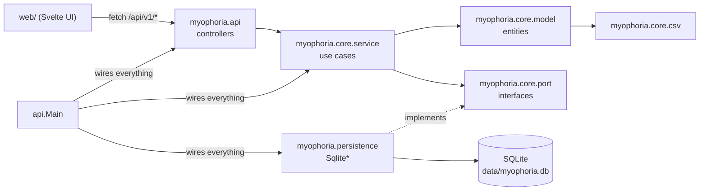

# Code documentation

What every class, interface, record and enum does, how they connect, and how a
request travels through the program. For design rules see
[DESIGN.md](DESIGN.md); for the UML class diagram see
[uml/classes.md](uml/classes.md); for endpoints see [API.md](API.md).

## 1. The big picture

Ports and adapters: the core knows nothing about HTTP or SQLite. Arrows point
in the direction of "depends on / calls".



Rule: `api` and `persistence` depend on `core`; `core` depends on nothing
outside the JDK. Only `Main` knows every layer, because it builds the objects.

## 2. Source tree

```
src/main/java/myophoria/
├── api/                 HTTP adapter (Javalin)
│   ├── Main             entry point, config, wiring, host check
│   ├── ErrorHandlers    exception → JSON error
│   └── *Controller      one per resource, registers routes
├── core/
│   ├── model/           entities + enums (domain rules live here)
│   ├── service/         use cases + result records
│   ├── port/            repository/backup interfaces the core needs
│   ├── csv/             CSV reading/writing helpers
│   └── error/           domain exceptions
└── persistence/         SQLite implementations of the ports
src/main/resources/db/migration/V1__init.sql   schema + seeded default gym
web/src/                 Svelte UI (built into src/main/resources/public/)
```

## 3. Core: model (`myophoria.core.model`)

### Type hierarchy

```
CsvSerializable (interface: toCsvRow)
├── Exercise (abstract)            ── implements CsvSerializable
│   ├── BarbellExercise            weight = total incl. bar
│   ├── DumbbellExercise           weight = per dumbbell, shown "… each"
│   ├── StackExercise              weight = stack setting
│   ├── PlateLoadedExercise        weight = plates added
│   └── CalisthenicsExercise       weight = added load (0 allowed), needs bodyweight
├── Gym
├── WorkoutSession                 ── also VolumeCalculable
├── WorkoutSet                     ── also VolumeCalculable
├── BodyweightEntry
└── WorkoutTemplate

VolumeCalculable (interface: volume(Unit))
├── WorkoutSession   sum of its sets
└── WorkoutSet       weight × reps for working sets, 0 for warm-ups
```

### Classes

| Type | Kind | Responsibility |
|---|---|---|
| `Exercise` | abstract class | A lift in the library. Holds id, name (+ normalised `nameKey` for uniqueness), laterality, soft-delete time. `Exercise.of(type, …)` is the only place that maps an `EquipmentType` to a subclass. Subclasses override only what differs: `type()`, `weightLabel()`, and optionally `validateWeight`, `requiresBodyweight`, `formatSet`. Also `initials()` and `warmupWeight()` (80 % of last top set). |
| `BarbellExercise`, `DumbbellExercise`, `StackExercise`, `PlateLoadedExercise`, `CalisthenicsExercise` | classes | The five equipment types (polymorphism instead of `if type ==`). |
| `Gym` | class | Where workouts happen. Exactly one active gym is the default; `SEEDED_DEFAULT_ID` is created by the migration. |
| `WorkoutSession` | class | One workout on one day at one gym. Holds its `WorkoutSet`s, the open flag, start/end; `finish()`, `effectiveEnd()` (end, else last set), `duration()`, `volume()`. |
| `WorkoutSet` | class | One ticked set: exercise, position, `SetType`, weight + `Unit`, reps, optional bodyweight snapshot, completion time. Setters validate. |
| `BodyweightEntry` | class | One bodyweight measurement (independent of workouts). |
| `WorkoutTemplate` | class | Named, ordered list of exercise ids (no duplicates). |
| `EquipmentType` | enum | `BARBELL, DUMBBELL, STACK, PLATE_LOADED, CALISTHENICS`. |
| `Laterality` | enum | `BILATERAL, UNILATERAL` (informational). |
| `SetType` | enum | `WARMUP, WORKING, FAILURE`; `isWorking()` excludes warm-ups from numbers. |
| `Unit` | enum | `KG, LB` with exact conversion (`1 lb = 0.45359237 kg`). |
| `VolumeCalculable` | interface | `volume(Unit)` for sets and sessions. |

Every entity validates in its constructor/setters and throws
`InvalidWorkoutInputException`, so an invalid object cannot exist. Each also
has a static `HEADER` and `fromCsvRow(String[])` for CSV.

## 4. Core: services (`myophoria.core.service`)

Services are the use cases. They take ports (and a `Clock` where time
matters) in their constructor, so tests run them on in-memory fakes.

| Service | Uses ports | Does |
|---|---|---|
| `ExerciseService` | `ExerciseRepository`, `Backups` | search/list, create, edit (type locked once sets exist), soft delete, restore, usage count, permanent delete (backup first). Name clashes → `DuplicateResourceException`. |
| `GymService` | `GymRepository`, `SessionRepository` | list, create, rename, make default, soft delete (not the default/last one), `activeGym()` = gym of latest session else default. Defines `CHRONOLOGICAL` session order. |
| `WorkoutService` | `SessionRepository`, `SetRepository`, `ExerciseRepository`, `GymRepository`, `BodyweightRepository` | the live workout: `start`, `addSet`, `updateSet`, `deleteSet`, `finish`, and `prefill` (last session's rows at the same gym, warm-up weight, latest bodyweight). |
| `HistoryService` | `SessionRepository`, `GymRepository` | filtered history list, view, backfill a past workout, edit session details, delete. |
| `ReportService` | `SessionRepository`, `ExerciseRepository` | session `summary` and per-exercise `progression` (top working weight per session), in a reporting unit. |
| `BodyweightService` | `BodyweightRepository` | list (newest first), latest, create, update, delete. |
| `TemplateService` | `TemplateRepository`, `ExerciseRepository`, `SessionRepository` | list (hides deleted exercises), create, update, delete, save a session as a template. |
| `CsvService` | all six repositories + `Backups` | `export` everything as a ZIP of CSVs; `importZip` (manifest check → backup → import file by file, never overwriting; reports skipped, orphan, conflicting and adjusted rows). |

Result/input records (plain data, no logic):

| Record | Used by | Holds |
|---|---|---|
| `SetInput` | `WorkoutService` | values for adding/editing a set |
| `HistoryFilter` | `HistoryService.list` | optional date range, gym, exercise |
| `SessionHeader` | `HistoryService.list` | one history row |
| `SessionSummary`, `ExerciseSummary` | `ReportService.summary` | totals and per-exercise numbers |
| `ProgressPoint` | `ReportService.progression` | date + top weight |
| `Prefill`, `PrefillRow` | `WorkoutService.prefill` | suggested rows for an exercise card |
| `Usage` | `ExerciseService.usage` | sets/sessions a permanent delete would erase |
| `ImportReport`, `FileReport` | `CsvService.importZip` | per-file import outcome |

## 5. Core: ports, CSV, errors

**Ports** (`myophoria.core.port`) — interfaces the services need; `findById`
returns `null` when missing and the service turns that into `NotFoundException`.

| Interface | Implemented by | Test fake |
|---|---|---|
| `ExerciseRepository` | `SqliteExerciseRepository` | `FakeExerciseRepository` |
| `GymRepository` | `SqliteGymRepository` | `FakeGymRepository` |
| `SessionRepository` | `SqliteSessionRepository` | `FakeWorkoutStore` |
| `SetRepository` | `SqliteSetRepository` | `FakeWorkoutStore` |
| `BodyweightRepository` | `SqliteBodyweightRepository` | `FakeBodyweightRepository` |
| `TemplateRepository` | `SqliteTemplateRepository` | `FakeTemplateRepository` |
| `Backups` | `SqliteBackups` | `FakeBackups` |

**CSV** (`myophoria.core.csv`)
- `CsvSerializable` — interface: `toCsvRow()`.
- `CsvCodec` — RFC 4180 `formatRow`/`parse` (quotes, embedded line breaks,
  BOM, CRLF), field parsers (`number`, `instant`, `date`, `enumValue`, …) and
  the shared millisecond UTC `TIMESTAMP` format also used by the database.

**Errors** (`myophoria.core.error`) and the HTTP status they become in `ErrorHandlers`:

| Exception | Checked? | Meaning | HTTP |
|---|---|---|---|
| `InvalidWorkoutInputException` | no | a domain rule was broken | 400 `INVALID_INPUT` |
| `NotFoundException` | no | unknown id | 404 `NOT_FOUND` |
| `DuplicateResourceException` | no | active name already used (carries id and whether it is soft-deleted, so the UI can offer restore) | 409 `DUPLICATE_RESOURCE` |
| `CorruptedCsvException` | yes | bad CSV/ZIP/manifest (file + line + reason) | 422 `CORRUPTED_CSV` |

## 6. Persistence (`myophoria.persistence`)

| Class | Does |
|---|---|
| `Database` | Owns the SQLite file. `open()`: create the data dir, recover from a corrupt file (rename it aside, restore the newest healthy backup, return warnings for the UI), enable WAL, run `Migrator`. `connect()` gives a new connection with foreign keys on. |
| `Migrator` | Runs `db/migration/V*.sql` scripts newer than `PRAGMA user_version`, each in a transaction. |
| `SqliteBackups` | `Backups` port: `VACUUM INTO` a `.tmp` file, then atomic rename to `backups/myophoria-<UTC time>.db`. |
| `Sqlite*Repository` (6) | One per port. Plain JDBC, one connection per call, `IllegalStateException` on SQL errors. `SqliteSessionRepository` loads sessions and all their sets in two queries inside one read transaction. `SqliteExerciseRepository.deletePermanently` and `SqliteTemplateRepository` writes run in a transaction. |

Tables (`V1__init.sql`): `gyms`, `exercises`, `workout_sessions`,
`workout_sets`, `bodyweight_entries`, `workout_templates`,
`template_exercises`. Partial unique indexes enforce one default gym, one open
session and unique active names.

## 7. API (`myophoria.api`)

| Class | Does |
|---|---|
| `Main` | Reads env (`MYOPHORIA_PORT`, `MYOPHORIA_DATA_DIR`, `MYOPHORIA_ALLOWED_HOSTS`), opens the `Database`, builds every repository → service → controller by hand (`createApp`), configures Jackson, static files and a `before("/api/*")` Host/Origin check, and starts Javalin on 127.0.0.1. |
| `ErrorHandlers` | Maps exceptions to `{error, message, details?}` JSON (table in §5); unknown exceptions → 500 without leaking the message. |
| `ExerciseController` | `/exercises…` → `ExerciseService` |
| `GymController` | `/gyms…` → `GymService` |
| `WorkoutController` | `/sessions/open`, `/sessions/start`, `/sessions/{id}/finish`, `/prefill`, `/sets` → `WorkoutService`. Defines `SessionDto`/`SetDto`. Registered before `HistoryController` so `/sessions/open` beats `/sessions/{id}`. |
| `HistoryController` | `/sessions` list/view/backfill/edit/delete → `HistoryService` |
| `ReportController` | `/sessions/{id}/summary`, `/exercises/{id}/progression` → `ReportService` |
| `BodyweightController` | `/bodyweight…` → `BodyweightService` |
| `TemplateController` | `/templates…`, `/sessions/{id}/template` → `TemplateService` |
| `DataController` | `/status` (startup warnings), `/backups`, `/export`, `/import` → `Backups`, `CsvService` |

Controllers only translate: parse the request into a record (`*Request`),
call one service method, turn the result into a `*Dto` record.

## 8. Web UI (`web/src`)

```
main.ts → App.svelte ── picks a screen from the URL hash (lib/router)
  ├── components/  NavBar, StatusBanner (GET /status), ConfirmDialog,
  │                ExercisePicker, ProgressChart (SVG), Badge, ErrorText
  ├── screens/     Workout, ExerciseCard, Summary, History, SessionDetail,
  │                Exercises, ExerciseDetail, Templates, Gyms, Bodyweight,
  │                Data, More
  └── lib/
      ├── api.ts            the only place that calls fetch; throws ApiError
      ├── types.ts          TypeScript mirrors of the DTOs
      ├── workout.svelte.ts shared live-workout state (open session, cards, draft rows, template queue)
      ├── dialog.svelte.ts  promise-based confirm/choose dialog
      ├── router.svelte.ts  hash routing: #/history/<id> → ['history', '<id>']
      └── format.ts         dates, durations, rounding, set labels
```

Screens never call `fetch` directly; they call `api.*`. Unticked rows on an
exercise card are drafts that exist only in the browser; ticking one saves it.

## 9. Program paths

### Startup

```
Main.main
 ├─ Database.open()
 │   ├─ recoverIfCorrupt → restore newest healthy backup (warnings)
 │   ├─ PRAGMA journal_mode = WAL
 │   └─ Migrator.migrate → V1__init.sql (creates tables, seeds "Default" gym)
 └─ createApp(...)  new Sqlite*Repository → new *Service → new *Controller
     └─ Javalin.start("127.0.0.1", port)   serves /public (UI) and /api/v1
```

### Logging a set (the main path)

```
ExerciseCard.svelte  tick checkbox
 └─ api.addSet(sessionId, SetInput)            POST /api/v1/sessions/{id}/sets
     └─ Main before-filter: Host/Origin allowed?            (else 403)
         └─ WorkoutController → ctx.bodyAsClass(SetInput)  (bad JSON → 400)
             └─ WorkoutService.addSet
                 ├─ SessionRepository.findById      (missing → 404)
                 ├─ ExerciseRepository.findById
                 ├─ exercise.validateWeight / requiresBodyweight  (polymorphic rule)
                 ├─ new WorkoutSet(...)              (field rules → 400)
                 └─ SetRepository.insert → SqliteSetRepository → INSERT
             └─ SetDto.of(set, exercise)  → JSON 201 (display text via exercise.formatSet)
```

Every other request follows the same shape: **screen → `api.ts` → host check →
controller → service → model rules → port → Sqlite repository**, and any
exception on the way back is turned into JSON by `ErrorHandlers`.

### Other flows in one line each

- **Start**: `Workout.svelte` → `POST /sessions/start` → `WorkoutService.start` (one open session; active gym).
- **Prefill**: opening a card → `GET /sessions/{id}/prefill` → `WorkoutService.prefill` reads past sessions at the same gym.
- **Finish**: `finishWorkout()` → `POST /sessions/{id}/finish` (or delete when no sets) → `Summary.svelte` → `ReportService.summary`.
- **Permanent delete**: `ExerciseService.deletePermanently` → `Backups.createBackup` → `SqliteExerciseRepository.deletePermanently` (one transaction).
- **Import**: `Data.svelte` → `POST /import` → `CsvService.importZip`: unzip (64 MB cap) → manifest check → backup → gyms, exercises, sessions, sets, bodyweight, templates (parents first, so orphans are detected) → `ImportReport`.
- **Export**: `GET /export` → `CsvService.export` → ZIP of seven CSV files (see [DATA_FORMAT.md](DATA_FORMAT.md)).

## 10. Tests (`src/test/java/myophoria`)

| Package | Tests |
|---|---|
| `core.model`, `core.csv` | entity rules, units, CSV parsing/round trip |
| `core.service` | every service on in-memory fakes from `core.fake` |
| `persistence` | each SQLite repository, backups, corruption recovery, permanent delete, CSV round trip through a real database |
| `api` | HTTP end to end on a random port (`ApiTestSupport` starts `Main.createApp` on a temp database) |
