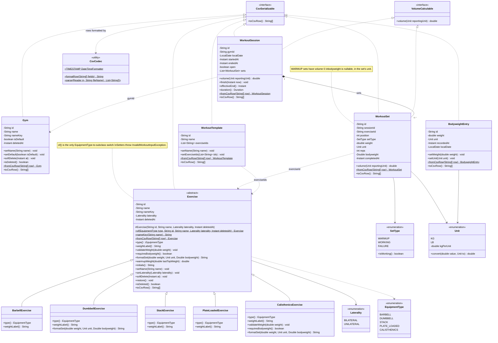
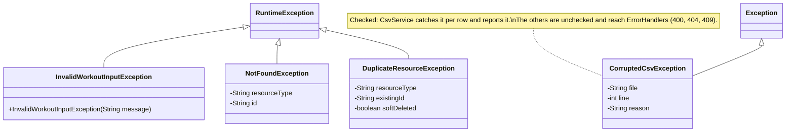
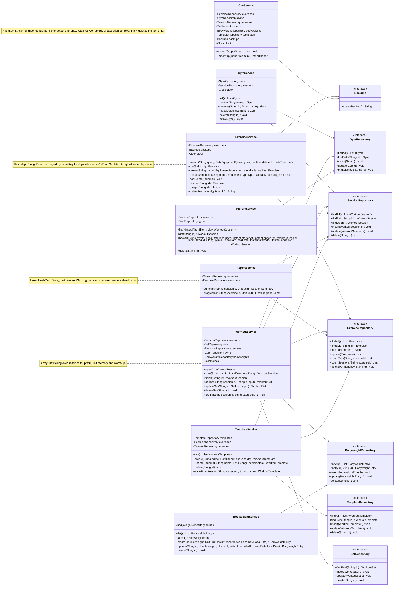
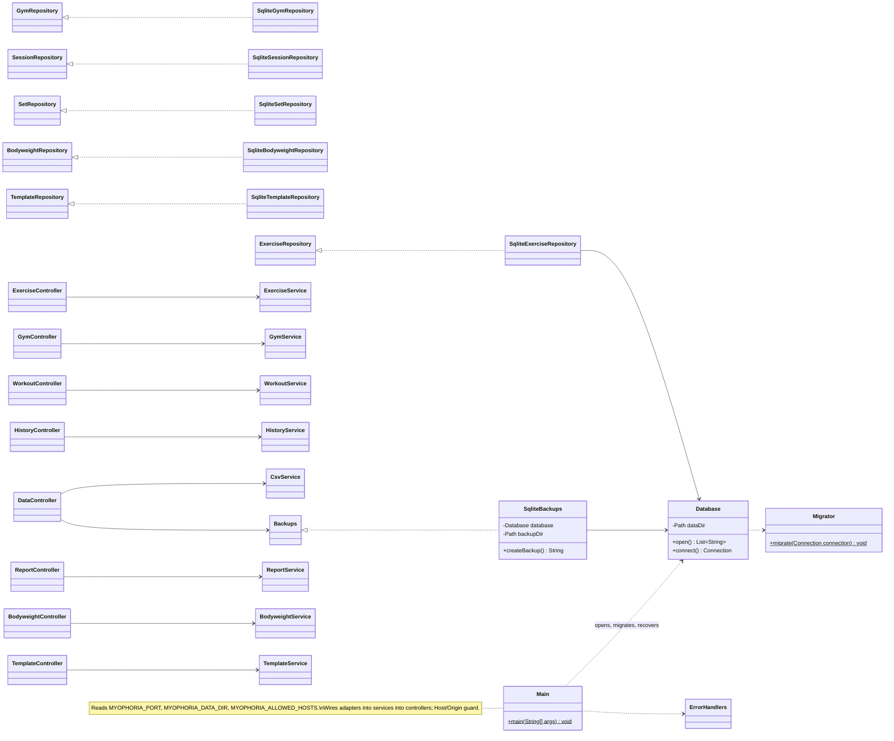

# UML class diagrams

Status: **design draft from PLAN.md §4 (Gate C, 2026-11-25).** Task T7.1 regenerates these diagrams from the finished code; the final version must match the code exactly.

Notation: `-` private, `#` protected, `+` public, `$` static, `*` abstract. `?` in a note marks a nullable value.

## 1. Domain model (`myophoria.core.model`, `myophoria.core.csv`, `myophoria.core.error`)

### Exceptions

## 2. Ports and services (`myophoria.core.port`, `myophoria.core.service`)

`CsvService` also uses every other repository; those arrows are left out for readability.

### Service result records

| Record | Fields |
|---|---|
| `SetInput` | `exerciseId, setType, weight, unit, reps, bodyweight?, position` |
| `Prefill` | `unit, List<PrefillRow> rows, warmupWeight?, bodyweight?` |
| `PrefillRow` | `setType, weight, reps` |
| `HistoryFilter` | `from?, to?, gymId?, exerciseId?` |
| `SessionSummary` | `totalSets, workingSets, totalVolume, List<ExerciseSummary> exercises, startedAt?, endedAt?, duration?` |
| `ExerciseSummary` | `exerciseId, name, workingSets, topWeight, averageWeight, volume` |
| `ProgressPoint` | `localDate, topWeight` |
| `Usage` | `sets, sessions` |
| `ImportReport` | `Map<String, FileReport> files` |
| `FileReport` | `imported, alreadyPresent, List<String> skipped, List<String> orphans, List<String> nameConflicts` |

## 3. Adapters (`myophoria.persistence`, `myophoria.api`)

Every SQLite repository holds a `Database` and opens one connection per call; only two of those arrows are drawn. Controllers declare their request and response records as nested types.
