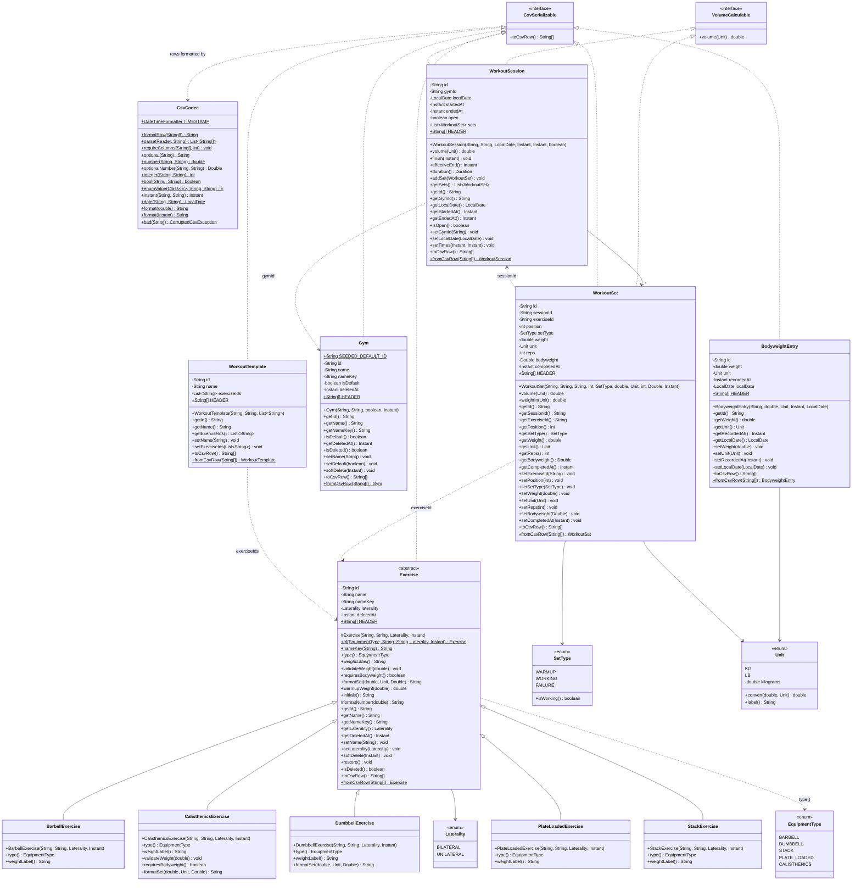
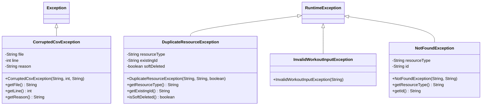
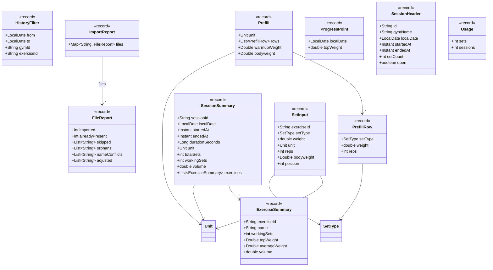
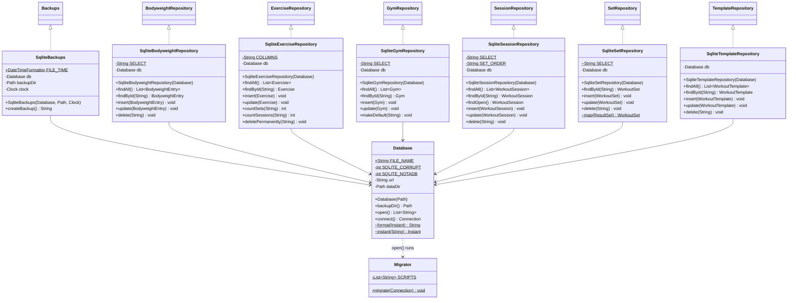

# UML class diagrams

Generated from the compiled code on 2026-11-25 (T7.1) with `javap -p`, so every class, field and non-private method below is in the code. Regenerate after any change to a class's members.

Notation: `-` private, `#` protected, `+` public, `~` package-private, `$` static, `*` abstract. Parameters show types only. Left out: private helper methods, lambdas, the generated members of records and enums (`equals`, `hashCode`, `toString`, accessors, `values`, `valueOf`), and nested types (the controllers' request/response records and `CsvService`'s private `Row`/`Tally` helpers). A solid arrow `-->` is a field; a dotted arrow `..>` is a reference by id or a use without a field.

## 1. Domain model (`myophoria.core.model`, `myophoria.core.csv`)

## 2. Exceptions (`myophoria.core.error`)

`CorruptedCsvException` is checked: a broken CSV file is an expected, recoverable condition the importer must handle. The other three are unchecked and are mapped to HTTP status codes by `ErrorHandlers`.

## 3. Ports (`myophoria.core.port`)

The interfaces the core needs from the outside. `myophoria.persistence` implements them (section 6).

```mermaid
classDiagram
  direction TB

  class Backups {
    <<interface>>
    +createBackup() String
  }
  class BodyweightRepository {
    <<interface>>
    +findAll() List~BodyweightEntry~
    +findById(String) BodyweightEntry
    +insert(BodyweightEntry) void
    +update(BodyweightEntry) void
    +delete(String) void
  }
  class ExerciseRepository {
    <<interface>>
    +findAll() List~Exercise~
    +findById(String) Exercise
    +insert(Exercise) void
    +update(Exercise) void
    +countSets(String) int
    +countSessions(String) int
    +deletePermanently(String) void
  }
  class GymRepository {
    <<interface>>
    +findAll() List~Gym~
    +findById(String) Gym
    +insert(Gym) void
    +update(Gym) void
    +makeDefault(String) void
  }
  class SessionRepository {
    <<interface>>
    +findAll() List~WorkoutSession~
    +findById(String) WorkoutSession
    +findOpen() WorkoutSession
    +insert(WorkoutSession) void
    +update(WorkoutSession) void
    +delete(String) void
  }
  class SetRepository {
    <<interface>>
    +findById(String) WorkoutSet
    +insert(WorkoutSet) void
    +update(WorkoutSet) void
    +delete(String) void
  }
  class TemplateRepository {
    <<interface>>
    +findAll() List~WorkoutTemplate~
    +findById(String) WorkoutTemplate
    +insert(WorkoutTemplate) void
    +update(WorkoutTemplate) void
    +delete(String) void
  }


```

## 4. Services (`myophoria.core.service`)

```mermaid
classDiagram
  direction TB

  class BodyweightService {
    -String RESOURCE$
    +Comparator~BodyweightEntry~ NEWEST_FIRST$
    -BodyweightRepository entries
    +BodyweightService(BodyweightRepository)
    +list() List~BodyweightEntry~
    +latest() BodyweightEntry
    +create(double, Unit, Instant, LocalDate) BodyweightEntry
    +update(String, double, Unit, Instant, LocalDate) BodyweightEntry
    +delete(String) void
  }
  class CsvService {
    +String FORMAT_VERSION$
    ~String[] MANIFEST_HEADER$
    ~long MAX_UNZIPPED_BYTES$
    -GymRepository gyms
    -ExerciseRepository exercises
    -SessionRepository sessions
    -SetRepository sets
    -BodyweightRepository bodyweights
    -TemplateRepository templates
    -Backups backups
    -Clock clock
    +CsvService(GymRepository, ExerciseRepository, SessionRepository, SetRepository, BodyweightRepository, TemplateRepository, Backups, Clock)
    +export(OutputStream) void
    +importZip(InputStream) ImportReport
  }
  class ExerciseService {
    -String RESOURCE$
    -Comparator~Exercise~ BY_NAME$
    -ExerciseRepository exercises
    -Backups backups
    -Clock clock
    +ExerciseService(ExerciseRepository, Backups, Clock)
    +search(String, Set~EquipmentType~, boolean) List~Exercise~
    +get(String) Exercise
    +allById() Map~String, Exercise~
    +create(String, EquipmentType, Laterality) Exercise
    +update(String, String, EquipmentType, Laterality) Exercise
    +softDelete(String) Exercise
    +restore(String) Exercise
    +usage(String) Usage
    +deletePermanently(String) String
  }
  class GymService {
    -String RESOURCE$
    -Comparator~Gym~ BY_NAME$
    +Comparator~WorkoutSession~ CHRONOLOGICAL$
    -GymRepository gyms
    -SessionRepository sessions
    -Clock clock
    +GymService(GymRepository, SessionRepository, Clock)
    +list() List~Gym~
    +get(String) Gym
    +create(String) Gym
    +rename(String, String) Gym
    +makeDefault(String) Gym
    +delete(String) void
    +activeGym() Gym
  }
  class HistoryService {
    +Comparator~WorkoutSession~ NEWEST_FIRST$
    -SessionRepository sessions
    -GymRepository gyms
    +HistoryService(SessionRepository, GymRepository)
    +list(HistoryFilter) List~SessionHeader~
    +get(String) WorkoutSession
    +backfill(String, LocalDate, Instant, Instant) WorkoutSession
    +edit(String, String, LocalDate, Instant, Instant) WorkoutSession
    +delete(String) void
  }
  class ReportService {
    -SessionRepository sessions
    -ExerciseRepository exercises
    +ReportService(SessionRepository, ExerciseRepository)
    +summary(String, Unit) SessionSummary
    +progression(String, Unit) List~ProgressPoint~
  }
  class TemplateService {
    -String RESOURCE$
    -Comparator~WorkoutTemplate~ BY_NAME$
    -TemplateRepository templates
    -ExerciseRepository exercises
    -SessionRepository sessions
    +TemplateService(TemplateRepository, ExerciseRepository, SessionRepository)
    +list() List~WorkoutTemplate~
    +create(String, List~String~) WorkoutTemplate
    +update(String, String, List~String~) WorkoutTemplate
    +delete(String) void
    +saveFromSession(String, String) WorkoutTemplate
  }
  class WorkoutService {
    -Comparator~WorkoutSet~ BY_POSITION$
    -SessionRepository sessions
    -SetRepository sets
    -ExerciseRepository exercises
    -GymRepository gyms
    -BodyweightRepository bodyweights
    -Clock clock
    +WorkoutService(SessionRepository, SetRepository, ExerciseRepository, GymRepository, BodyweightRepository, Clock)
    +open() WorkoutSession
    +start(String, LocalDate) WorkoutSession
    +finish(String) WorkoutSession
    +addSet(String, SetInput) WorkoutSet
    +updateSet(String, SetInput) WorkoutSet
    +deleteSet(String) void
    +prefill(String, String) Prefill
  }

  BodyweightService --> BodyweightRepository
  CsvService --> GymRepository
  CsvService --> ExerciseRepository
  CsvService --> SessionRepository
  CsvService --> SetRepository
  CsvService --> BodyweightRepository
  CsvService --> TemplateRepository
  CsvService --> Backups
  ExerciseService --> ExerciseRepository
  ExerciseService --> Backups
  GymService --> GymRepository
  GymService --> SessionRepository
  HistoryService --> SessionRepository
  HistoryService --> GymRepository
  ReportService --> SessionRepository
  ReportService --> ExerciseRepository
  TemplateService --> TemplateRepository
  TemplateService --> ExerciseRepository
  TemplateService --> SessionRepository
  WorkoutService --> SessionRepository
  WorkoutService --> SetRepository
  WorkoutService --> ExerciseRepository
  WorkoutService --> GymRepository
  WorkoutService --> BodyweightRepository
```

## 5. Service inputs and results (records in `myophoria.core.service`)

## 6. Persistence adapters (`myophoria.persistence`)

## 7. HTTP adapters and bootstrap (`myophoria.api`)

```mermaid
classDiagram
  direction TB

  class BodyweightController {
    -BodyweightService service
    +BodyweightController(BodyweightService)
    +register(RoutesConfig) void
  }
  class DataController {
    -List~String~ warnings
    -Backups backups
    -CsvService csv
    +DataController(List~String~, Backups, CsvService)
    +register(RoutesConfig) void
  }
  class ErrorHandlers {
    -Logger LOG$
    +register(JavalinConfig) void$
  }
  class ExerciseController {
    -ExerciseService service
    +ExerciseController(ExerciseService)
    +register(RoutesConfig) void
  }
  class GymController {
    -GymService service
    +GymController(GymService)
    +register(RoutesConfig) void
  }
  class HistoryController {
    -HistoryService history
    -ExerciseService exercises
    +HistoryController(HistoryService, ExerciseService)
    +register(RoutesConfig) void
  }
  class Main {
    -Set~String~ LOCAL_HOSTS$
    +Main()
    +main(String[]) void$
    ~createApp(Database, Path, List~String~, Set~String~) Javalin$
    ~jsonMapper() ObjectMapper$
    ~hostAllowed(String, boolean, Set~String~) boolean$
  }
  class ReportController {
    -ReportService reports
    +ReportController(ReportService)
    +register(RoutesConfig) void
    ~unit(String) Unit$
  }
  class TemplateController {
    -TemplateService templates
    -ExerciseService exercises
    +TemplateController(TemplateService, ExerciseService)
    +register(RoutesConfig) void
  }
  class WorkoutController {
    -WorkoutService workouts
    -ExerciseService exercises
    +WorkoutController(WorkoutService, ExerciseService)
    +register(RoutesConfig) void
  }

  BodyweightController --> BodyweightService
  DataController --> Backups
  DataController --> CsvService
  ExerciseController --> ExerciseService
  GymController --> GymService
  HistoryController --> HistoryService
  HistoryController --> ExerciseService
  ReportController --> ReportService
  TemplateController --> TemplateService
  TemplateController --> ExerciseService
  WorkoutController --> WorkoutService
  WorkoutController --> ExerciseService
  Main ..> Database : opens
  Main ..> ErrorHandlers : registers
  Main ..> DataController : wires every controller
```

